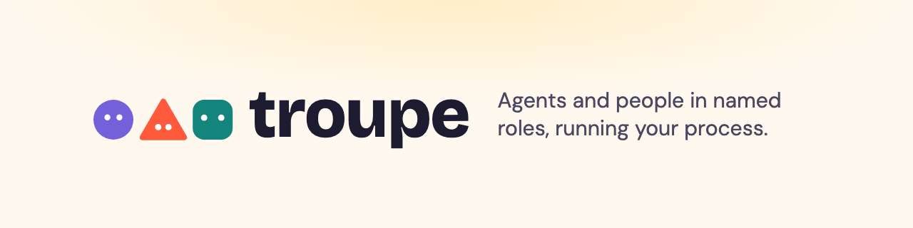

# website
troupe.run — website and landing page

## Development

See [CONTRIBUTING.md](CONTRIBUTING.md): you need uv and Node, and `uv run scripts/check.py` runs every check CI
runs. Every change goes through an issue and an OpenSpec change ([CLAUDE.md](CLAUDE.md) has the workflow).
Design: `docs/superpowers/specs/2026-10-07-troupe-run-site-design.md`.
Brand: `docs/brand-guide.md`.

## Licence

- **Site code** (templates, components, styles, scripts, build config): [MIT](LICENSE).
- **Content** (page copy, docs prose, images and diagrams): [CC BY 4.0](LICENSE-CONTENT).
- **The troupe name, logo and mark** are trademarks of HPS.GD PTY LTD and are not licensed under either of the above.

Copyright © 2026 HPS.GD PTY LTD.
